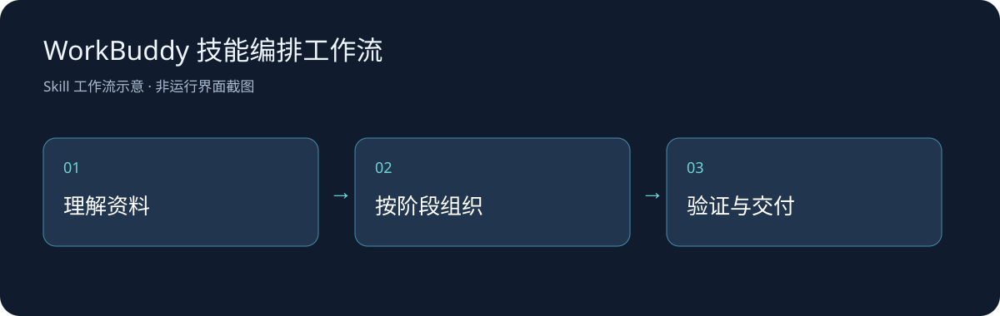

# WorkBuddy 技能编排工作流

以领域目录组织复合任务的历史版工作流，提供任务识别、技能匹配、执行顺序和交付检查建议。

## 实际范围

先核实当前宿主的技能目录；本仓库不包含目录中提到的第三方技能，也不证明它们已经安装或获得授权。

## 安装与调用

1. 准备支持 `SKILL.md` 的AI Agent宿主。
2. 将完整目录以 `skill-orchestration-brain` 放入该宿主的用户技能目录；Codex示例为当前用户下的 `.codex/skills/`，其他宿主按其说明配置。
3. 保留正文与子目录相对结构，重新加载技能清单；调用方式取决于宿主。

示例：

> 用 $skill-orchestration-brain 只读分析一个需要数据清洗与可视化的任务，先核实可用能力并给出执行顺序。

## 技术与文件

Markdown工作流与参考模板由宿主按需读取；提到的外部Skill属于各自维护者，未随本仓库重新分发。真实比赛材料、客户资料、账号配置、私人状态和依赖缓存不在仓库内。

## 验证、更新与计划

2026-10-26：归档原有完整技能正文和已存在的参考/脚本，补充结构检查、安装示例和工作流图；消除历史清单被误认为当前能力的歧义。此次检查相对引用与公开前敏感信息，辅助CLI有单独实际运行记录；未进行新的完整宿主模型会话验收，也未重新完成所描述的研究或网站开发。

后续根据真实宿主使用情况补充案例、兼容性和验证记录。自有工作流、脚本和公开整理采用 [MIT](LICENSE)，第三方软件、文献和原研究数据保留其归属；本协议不重新许可外部Skill。
